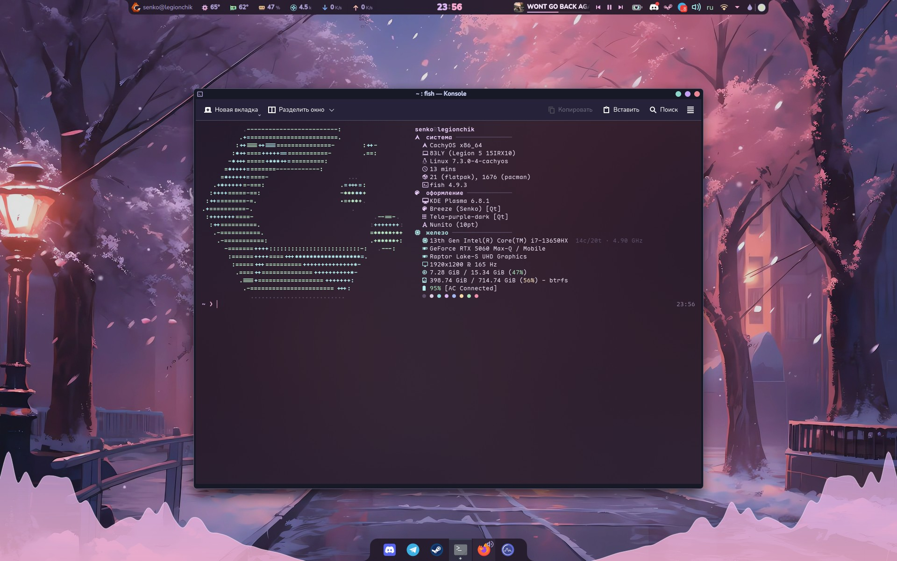

# 🦊 cachyos-my-kde-theme

Моё оформление KDE Plasma 6 на CachyOS: тёмно-сливовые панели с вогнутыми углами, пастельные виджеты, живые обои с сакурой, аудио-визуализатор у нижнего края и уютный терминал.




## Что внутри

| Часть | Что делает |
|---|---|
| **Верхняя панель** | Короче экрана, с вогнутыми углами у края; при развёрнутом окне плавно растягивается на всю ширину (патч Panel Colorizer) |
| **Док** | Скруглённый, по размеру содержимого, плавно прячется от окон |
| `senko.sysinfo` | Температуры CPU/GPU, память, вентилятор, сеть — цветные иконки, шрифт Nunito |
| `senko.clock` | Часы скруглённым шрифтом в цветах темы, по клику — календарь |
| `senko.player` | Плеер (MPRIS): обложка, название, прогресс, кнопки; без музыки сворачивается |
| `senko.battery` | Батарейка с цветной заливкой, подсказка с оставшимся временем |
| `senko.legionmode` | Кольцо-логотип Lenovo Legion: цвет как у кнопки питания (синий/белый/красный/фиолетовый), меню режимов и температуры. Фиолетовый «игровой» режим запускает `lenovo-tune.service` (настраивается отдельно, под конкретный ноутбук) |
| `senko.deskclock` | Большие часы с градиентом на рабочем столе |
| `senko.video` | Плагин живых обоев: видео по кругу, **пауза под развёрнутыми окнами и в играх** |
| `kava-overlay` | Визуализатор CAVA волнами по нижним краям экрана (layer-shell, клики насквозь) |
| `smoothmaximize` | Эффект KWin: плавное разворачивание окон без рывков |
| `popupzoom` | Эффект KWin: меню панели появляются масштабированием от панели |
| Терминал | Профиль Konsole «Senko», шрифт Maple Mono NF, промпт fish, fastfetch по блокам |
| Шрифты | Интерфейс — [Nunito](https://fonts.google.com/specimen/Nunito), моноширинный — [Maple Mono NF](https://github.com/subframe7536/maple-font) |

## Установка

Нужны: Plasma 6.8 (Wayland), Panel Colorizer **8.1.0** и несколько пакетов:

```bash
paru -S plasma6-applets-panel-colorizer cava pyside6 layer-shell-qt qt6-multimedia-ffmpeg qt6-5compat fastfetch fish ffmpeg
```

Дальше:

```bash
git clone https://github.com/P1KaChU337/cachyos-my-kde-theme
cd cachyos-my-kde-theme
./install.sh                          # виджеты, эффекты, шрифты, терминал, кава
./install.sh --layout --wallpapers    # + пересобрать панели и рабочий стол, скачать живые обои
```

- `--layout` **удаляет текущие панели** и собирает верхнюю панель и док как на скриншоте (перед этим делается бэкап конфигов).
- `--wallpapers` скачивает обои и подгоняет их под твой экран. Сакура прогоняется через нейросети [Real-ESRGAN](https://github.com/xinntao/Real-ESRGAN) и [RIFE](https://github.com/nihui/rife-ncnn-vulkan) (детализация + 60 к/с, нужна видеокарта с Vulkan, ~5 минут). Без нейросетей: `NO_AI=1 ./install.sh --wallpapers`.

Сами видео в репозиторий не входят — это чужие работы, скрипт берёт их из источников:
- Winter Cherry Blossom — [YouTube](https://www.youtube.com/watch?v=1t8Y1l9FIHY)
- Fox Anime Girl Shooting Stars — [MoeWalls](https://moewalls.com/anime/fox-anime-girl-shooting-stars-live-wallpaper/)

Своё видео можно улучшить тем же скриптом:

```bash
W=1920 H=1200 SET_WALLPAPER=1 ./tools/enhance-wallpaper.sh видео.mp4 результат.mp4
```

## Настройка

- **Живые обои:** ПКМ по рабочему столу → «Настроить рабочий стол» → «Senko Live Wallpaper»: видео, пауза под окнами, затемнение, скорость.
- **Кава:** в начале `~/.local/share/kava-overlay/kava-overlay.py` — `SENSITIVITY` (чувствительность), `BOOST` (усиление тихих звуков), `SIDE_FRACTION` (ширина волн), цвета — в `main.qml`.
- **Ширина верхней панели:** `margin.side` в пресетах `~/.config/panel-colorizer/presets/Senko Top*` (сейчас 275 px с каждой стороны) и `extend` в «Senko Top Maximized». Через режим редактирования Plasma длину лучше не менять — это ломает вогнутые углы.
- **Цвет панелей:** `backgroundColor.custom` в тех же пресетах (`#231b29`, 94%).

## Важно

- Оформление Plasma **Senko Glass** (`plasma-theme/senko-glass`) — копия Breeze, у всплывающих окон фон цвета терминала `rgb(27,22,33)` с прозрачностью 0.78 и размытием. Откат: `plasma-apply-desktoptheme default`.
- Patched Panel Colorizer лежит в `~/.local/share/plasma/plasmoids/` и перекрывает системный. **После обновления пакета Panel Colorizer** перезапусти `./install.sh`, чтобы наложить патч заново (`panel-colorizer/patches/`).
- Встроенный эффект KWin «Fading Popups» выключен — его работу делает `popupzoom`.

## Благодарности

- [Panel Colorizer](https://github.com/luisbocanegra/plasma-panel-colorizer) — luisbocanegra (патч основан на нём, GPL-3.0)
- `smoothmaximize` основан на эффекте KWin *maximize* (Martin Gräßlin, GPL-2.0+)
- [CAVA](https://github.com/karlstav/cava), [fastfetch](https://github.com/fastfetch-cli/fastfetch)

Лицензия: GPL-3.0.
